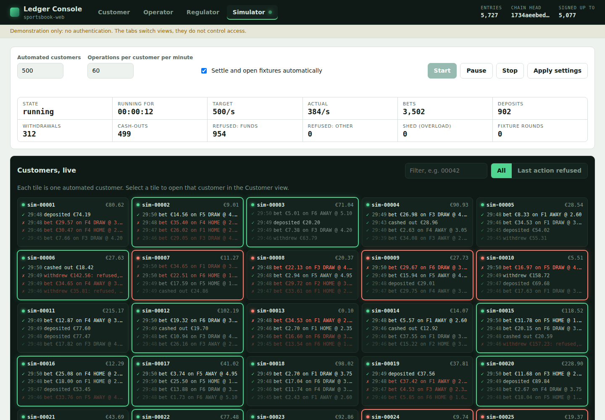
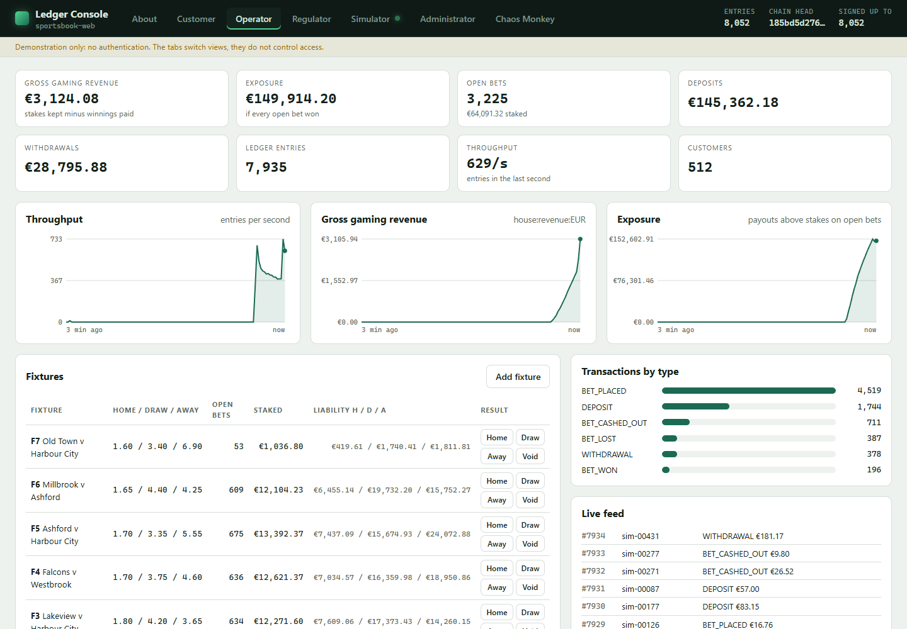
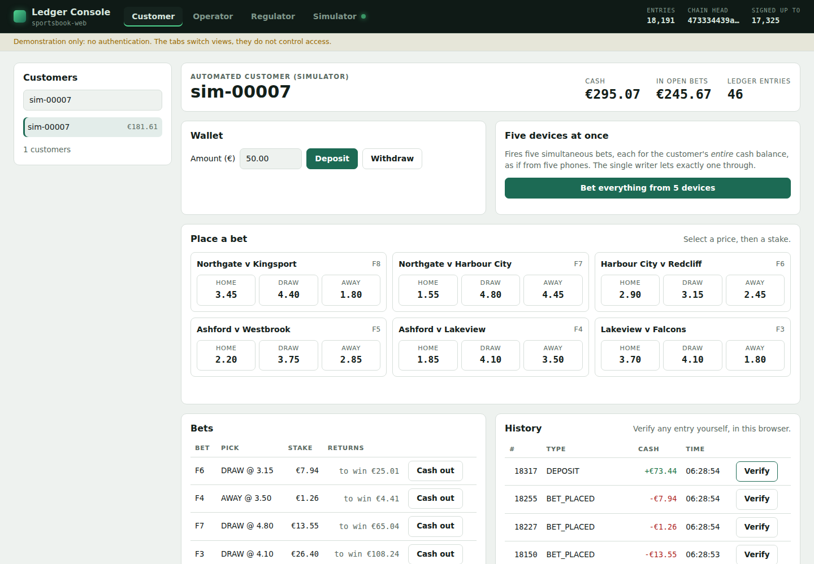
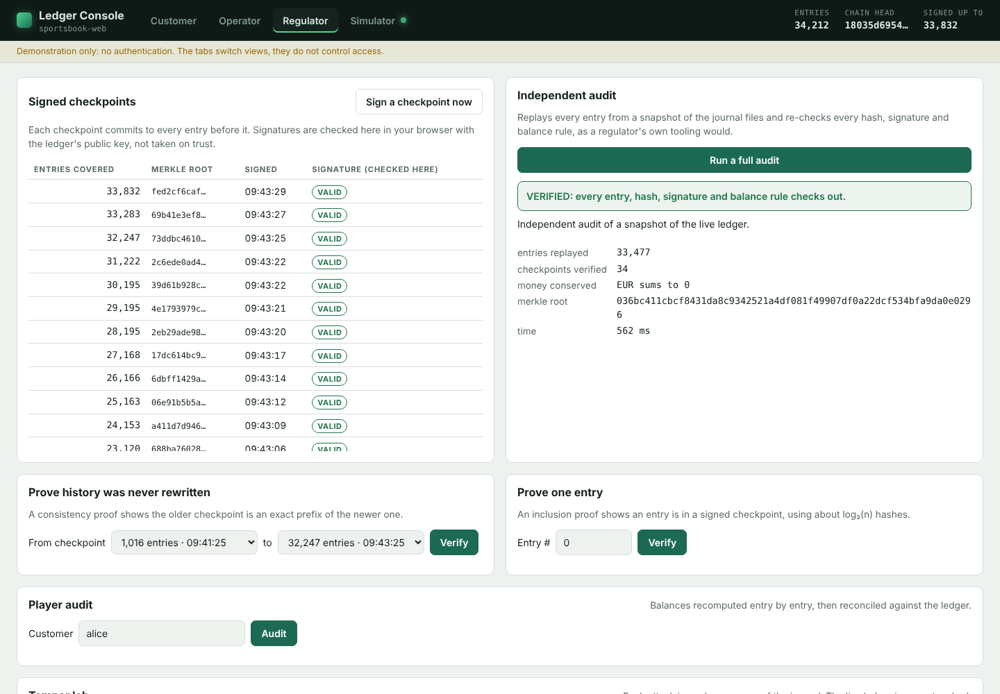
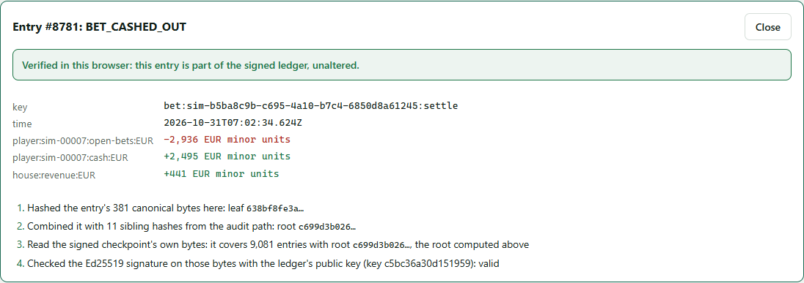

# PAM Ledger

A cryptographically verifiable, append-only, double-entry ledger for a sportsbook
player account management (PAM) platform, written in Kotlin with no runtime
dependencies beyond JDK 21.

**Start with the interactive guide: [paulmaddox.github.io/ledger](https://paulmaddox.github.io/ledger/).**
It includes an architecture map, hash-chain and Merkle-proof
playgrounds, and a step-through debugger that walks six scenarios (bet placement,
double-spend race, cash-out vs result, redelivered webhook, power cut, history
rewrite) over the real source code.

## Guarantees

| | |
|---|---|
| Tamper-evident | SHA-256 hash chain, RFC 9162 Merkle tree, Ed25519 signed tree heads |
| Linearizable | Single writer thread with group commit; lock-free reads of committed data only |
| Exactly-once | Idempotency keys with content fingerprints; one settlement key per bet |
| Crash-safe | Receipts issued only after fsync; torn tails quarantined, mid-file damage refused |
| Auditable | `LedgerVerifier` re-derives everything from the files and a public key |

## Quick start

You need [Git](https://git-scm.com) to get the code. Everything else is installed by one
command. Then one more runs the demo, or the web console.

**Ubuntu** (22.04 or newer):

```bash
git clone https://github.com/PaulMaddox/ledger.git && cd ledger
./scripts/setup.sh     # installs JDK 21 if needed, then does a first build
./gradlew run          # runs the demo
./gradlew web          # or: the web console, at http://localhost:8080
```

**Windows** (10 or 11), in PowerShell:

```powershell
git clone https://github.com/PaulMaddox/ledger.git; cd ledger
powershell -ExecutionPolicy Bypass -File scripts\setup.ps1   # installs JDK 21 with winget if needed, then does a first build
.\gradlew.bat run                                             # runs the demo
.\gradlew.bat web                                             # or: the web console, at http://localhost:8080
```

`-ExecutionPolicy Bypass` applies to that one run only: Windows blocks unsigned scripts
by default, and this does not change any setting.

The only thing installed system-wide is JDK 21. Gradle, the Kotlin compiler and the test
libraries are downloaded by the Gradle wrapper (`gradlew`) into your user folder on the
first build, which needs internet access and takes a few minutes. Both setup scripts are
safe to run again, and CI runs these exact commands on fresh Ubuntu and Windows machines.

## Web console

`./gradlew web` (Windows: `.\gradlew.bat web`) starts the ledger with a browser dashboard at
<http://localhost:8080>. It has a view for each persona, all working against the same live
ledger, so anything done in one view shows up in the others.



- **Simulator.** Choose how many automated customers to run (500 by default) and how active
  they are, then start, pause, resume or stop them. Each customer gets a tile streaming its
  latest bets, deposits, withdrawals and cash-outs, green when accepted and red when the
  ledger refuses. Counters and events belong to one run; late workers cannot pollute a restart.
  Automatic rounds retry unfinished fixtures using their already-recorded result, without
  starting duplicate settlement tasks.
  Select a tile to open that customer.
  Seed deposits are stable across retries and restarts; existing seed references are not funded again.
  Betting selects from a current-open fixture index rather than sorting completed fixture history.
  Accepted/refused events wait for the original wallet outcome; a slow response is never counted as a refusal.
  Customer IDs always use ASCII digits, independent of the host locale.
- **Customer.** Deposit, withdraw, bet on fixtures and cash out for any customer, human or
  automated. The latest 40 bets are read from that customer's indexed history, not a global scan.
  API monetary values are decimal strings in minor units, and browser inputs are parsed
  without floating-point rounding. Wallet actions retain the original customer, amount
  and idempotency reference after an uncertain response, so retries cannot silently become
  different money movements.
  Each slip keeps one bet ID, blocks overlapping submissions, and retries an
  uncertain response with the same player and stake. "Bet everything from 5 devices" fires five simultaneous bets for the whole
  balance of the customer captured at launch, cancelling if the selection changes before betting,
  to show that exactly one gets through. Any entry can be **verified in the browser**:
  it decodes and displays the canonical bytes (amounts in exact minor units), hashes them,
  walks the Merkle proof, and checks the Ed25519 signature with
  WebCrypto, rather than trusting the server.
- **Operator.** Revenue, exposure, throughput and open-bet charts with exact cumulative
  money totals, per-fixture liability,
  backed by current-open indexes that discard settled bets and empty fixture buckets,
  settlement buttons (all unfinished fixtures remain visible), and a live transaction feed.
  Settlement waits for each original
  in-flight placement's definitive result, including during queue overload.
- **Regulator.** Signed checkpoints verified in the browser, a full independent audit,
  with signature caching bound to the exact evidence, display commitments and public key,
  consistency and inclusion proofs, a per-customer audit trail, and a tamper lab that
  corrupts a *copy* of the signed journal prefix three different ways and shows the verifier
  catching each, even while the simulator appends new entries. Audit snapshots reread
  checkpoint records from disk through the captured checkpoint's position instead of
  trusting cached copies or unverified tree sizes. Player audits compare posting replays
  with immutable engine account states at each account's own last sequence.
  Signing times are decoded from the signed bytes.

| Operator | Customer |
|---|---|
|  |  |
| **Regulator** | **Verified in the browser** |
|  |  |

Options: `./gradlew web --args="--port 9090 --data build/web-ledger"`. Without `--data` the
ledger lives in a fresh temporary folder each run; with it, the ledger, signing key, fixture
definitions and results survive restarts. Fixture state is flushed before fixtures or
settlements are published, and startup reconciles it with recorded bets; missing or
contradictory results stay unresolved rather than being guessed. The console is a **demonstration
with no authentication**: the tabs are a view switch, not access control. Browser mutations
are restricted to same-origin requests and valid Host names; by default it listens on
localhost. It uses the JDK's built-in HTTP server and no front-end libraries, so the project
still has no runtime dependencies beyond the JDK.
Failed startup closes all acquired services and releases the writer lock, allowing a retry on the same data directory.

To listen on the LAN, explicitly allow the hostname or IP address users will access:
`./gradlew web --args="--host 0.0.0.0 --allowed-host ledger.example --allowed-host 192.0.2.10"`.
`--host` selects the bind address; repeat `--allowed-host` for additional exact hostnames or
IP addresses (without schemes, ports or wildcards). IPv6 wildcard binding uses `--host ::`.
Loopback access stays available with wildcard binding; other hosts and cross-origin
mutations remain blocked. Exposing this unauthenticated demo lets reachable users move money.

## Running

| | Ubuntu | Windows |
|---|---|---|
| Run the demo | `./gradlew run` | `.\gradlew.bat run` |
| Run the web console | `./gradlew web` | `.\gradlew.bat web` |
| Run all tests | `./gradlew test` | `.\gradlew.bat test` |
| Run one test class | `./gradlew test --tests "com.pam.ledger.MultiDeviceWalletTest"` | `.\gradlew.bat test --tests "com.pam.ledger.MultiDeviceWalletTest"` |

Test reports are written to `build/reports/tests/test/index.html`.

### What the demo does

The demo (`src/main/kotlin/com/pam/ledger/demo/Demo.kt`) creates a fresh ledger in a
temporary folder. It then:

1. deposits €100 for each of 50 players;
2. has 16 threads place and settle bets concurrently;
3. proves one deposit with a Merkle inclusion proof, and the ledger's history with a consistency proof;
4. runs the independent verifier over the files it wrote.

Output from a real run (yours will differ in counts, timings and hashes):

```
Committed 3008 entries in 1721 ms (1479 bets placed, 2521 rejected for funds)
p1 cash balance: €436.50
Inclusion proof for p1's deposit: 12 hashes, valid=true, signed root valid=true
Consistency proof 100 -> 3008: true

VERIFIED ✔
  entries:            3008
  chain head:         67be1d0bf972bb7bbf18f534e604d2e1f3973b4584600985dcb6fdb5d4898e7f
  merkle root:        d7080e7e754147c2567f83b96ebe3a7ebd87e922d618fa476686cd3adff3be52
  checkpoints:        6 verified (latest covers 3008)
  currency totals:    {EUR=0} (each must be 0)

Ledger files are in /tmp/pam-ledger-demo…
```

Bets rejected for funds are expected: the threads deliberately try to overspend, and the
ledger refuses. The ledger files stay in the temporary folder so you can inspect them.
The demo exits with a non-zero status if the audit fails, which is how CI uses it.

To run the demo as a standalone program instead, build a distribution once with
`./gradlew installDist` (Windows: `.\gradlew.bat installDist`), then run
`build/install/pam-ledger/bin/pam-ledger` (Windows: `build\install\pam-ledger\bin\pam-ledger.bat`).

### Editing the interactive guide

Rebuilding and checking the guide also needs Python 3.10+ and Node.js 18+. Add them by
running the setup script with an extra option:

```
./scripts/setup.sh --with-guide-tools                                        # Ubuntu
powershell -ExecutionPolicy Bypass -File scripts\setup.ps1 -WithGuideTools   # Windows
```

Then:

```
python3 scripts/build-readme.py   # rebuild docs/index.html (Windows: python instead of python3)
node scripts/check-guide.mjs      # headless check of the guide
node scripts/check-web.mjs        # console browser regression checks (no dependencies)
```

### Setting up by hand

The scripts only automate this: install JDK 21 (on Ubuntu `sudo apt install openjdk-21-jdk`;
on Windows `winget install EclipseAdoptium.Temurin.21.JDK`), then run any `gradlew` command.
Do not install Gradle separately; the wrapper fetches the exact version CI uses.

Contributing, including with coding agents: read [`AGENTS.md`](AGENTS.md) first. It lists
the invariants that must never be broken and the branch-and-pull-request workflow.

## Layout

```
src/main/kotlin/com/pam/ledger/
  Ledger.kt            engine: queue, writer thread, group commit, recovery
  SportsbookWallet.kt  deposits, withdrawals, bets, exactly-once settlement
  Replay.kt            balance rules, replay verification, checkpoint checks
  Journal.kt           CRC-framed append-only file, fsync, torn-write recovery
  Merkle.kt            incremental root, inclusion/consistency proofs
  Signing.kt           signed tree heads, pluggable signer (HSM/KMS)
  Hashes.kt, EntryCodec.kt, Validation.kt, Model.kt, Errors.kt, AppendOnlyList.kt
  LedgerVerifier.kt    offline auditor
  web/                 web console server: read model, book, simulator, regulator tools, HTTP API
src/main/resources/web/  web console front end (index.html, app.js, app.css; no libraries)
src/test/kotlin/com/pam/ledger/
  MultiDeviceWalletTest.kt   regulatory properties R1–R6 under multi-device load
  ConcurrencyTest.kt, IntegrityTest.kt, MerkleTest.kt
  WebAppTest.kt              web console API, simulator, and bets racing settlement
docs/
  readme.src.html      template for the interactive guide
  index.html           built guide, served by GitHub Pages (python3 scripts/build-readme.py)
scripts/
  setup.sh, setup.ps1  one-command developer setup for Ubuntu and Windows
  build-readme.py       builds docs/index.html from the template and real sources
  check-guide.mjs      headless check: debugger anchors, cloud data, test links
  capture-screenshots.py  regenerates docs/screenshots/ from the running web console
docs/screenshots/      web console screenshots used here and in the guide
```

## Before production

- Implement `TreeHeadSigner` against an HSM or cloud KMS.
- Publish signed tree heads to a party you do not control (regulator, transparency log).
- Move entry storage and Merkle nodes to an indexed store at large scale.
- Version `AccountPolicy` with the journal; replay enforces it.
