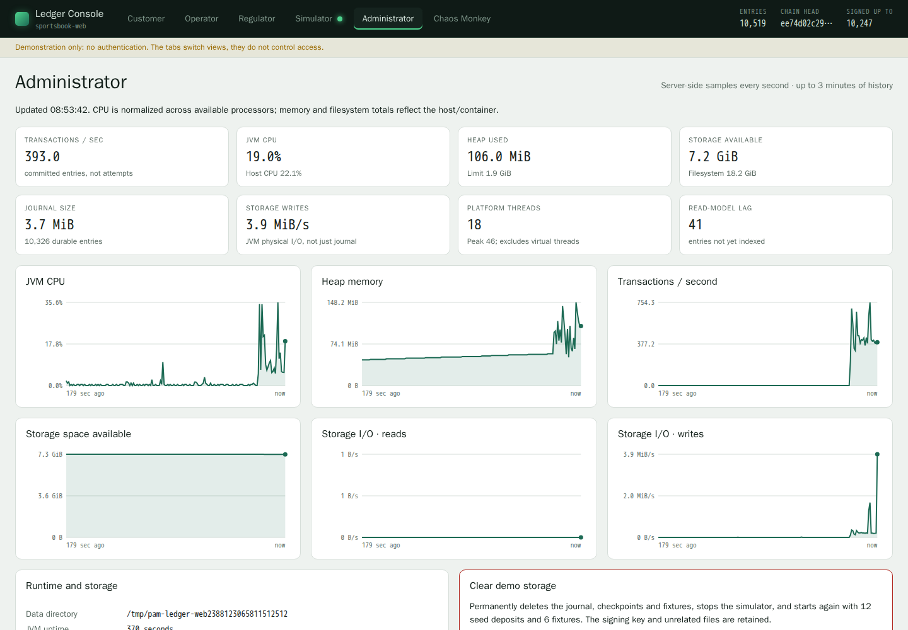
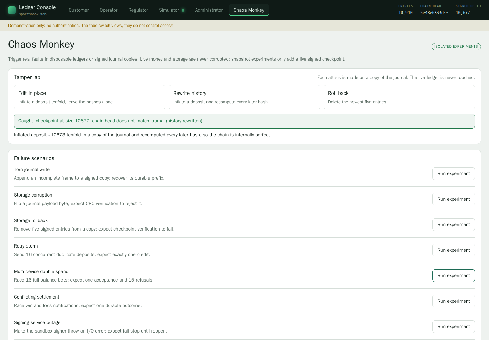

# PAM Ledger

An append-only, double-entry ledger for sportsbook player accounts. Built in
Kotlin on JDK 21, with exact money movements and cryptographic evidence you can
verify independently.

**[Try the live demo: Ledger Console →](https://paulmaddox-ledger-demo.swedencentral.cloudapp.azure.com/)**

**[Explore the interactive guide →](https://paulmaddox.github.io/ledger/)**
Follow the architecture, try the proof playgrounds, and step through real code.

## What it guarantees

| Property | What it means |
|---|---|
| Exact accounting | Money is conserved; player balances cannot go negative. |
| Safe concurrency | Competing bets and withdrawals cannot spend the same funds twice. |
| Exactly-once operations | Retrying an operation cannot move money again. |
| Durable receipts | An accepted transaction survives a restart. |
| Verifiable history | Independent audits and cryptographic proofs reveal tampering. |

## Quick start

Install [Git](https://git-scm.com), then choose your platform. The setup script
installs JDK 21 if needed and downloads the build tools. The first build needs
internet access and may take a few minutes.

**Ubuntu 22.04 or newer**

```bash
git clone https://github.com/PaulMaddox/ledger.git && cd ledger
./scripts/setup.sh
./gradlew web
```

**Windows 10 or 11 · PowerShell**

```powershell
git clone https://github.com/PaulMaddox/ledger.git; cd ledger
powershell -ExecutionPolicy Bypass -File scripts\setup.ps1
.\gradlew.bat web
```

Open **<http://localhost:8080>**. The Windows execution-policy option applies
only to that script run, not to your system settings.

Already have JDK 21? Skip setup and use the Gradle wrapper directly; you do not
need to install Gradle separately.

## See it in action

The web console gives customers, operators and regulators different views of the
same live ledger. Start the simulator, place a bet, settle a fixture, then verify
the resulting transaction in your browser.


| View | Try it |
|---|---|
| **Simulator** | Run hundreds of customers making bets, deposits, withdrawals and cash-outs. |
| **Customer** | Manage a wallet, race five devices for the same balance, and verify a receipt. |
| **Operator** | Follow revenue and exposure, settle fixtures, and watch transactions arrive. |
| **Regulator** | Audit the files independently and check signed checkpoints and proofs. |
| **Administrator** | Monitor performance and reset demo storage. |
| **Chaos Monkey** | Test double spending, conflicting settlements, outages and damaged history. |

| Operator | Customer |
|---|---|
|  |  |
| **Regulator** | **Verified in the browser** |
|  |  |
| **Administrator** | **Chaos Monkey** |
|  |  |

**Demo only: no authentication, synthetic money.** Every view is available to
anyone who can reach the console. Chaos Monkey can damage its history, and
Administrator reset permanently clears it. Never use real accounts, private
customer data or production keys.

Demo history resets daily at **03:00 UAE time**. Simulator runs stop after
**15 minutes**, including pauses; services stop at a **12 GB** storage high-water
mark until reset. These limits apply to the demo, not the ledger engine.

## Run and contribute

| Task | Ubuntu | Windows |
|---|---|---|
| CLI demo and independent audit | `./gradlew run` | `.\gradlew.bat run` |
| Web console | `./gradlew web` | `.\gradlew.bat web` |
| All tests | `./gradlew test` | `.\gradlew.bat test` |

The CLI demo places and settles bets concurrently, checks proofs, and audits the
files it wrote. Rejected overspending attempts are expected; an audit failure
causes a non-zero exit. Test reports are in `build/reports/tests/test/index.html`.

To build a standalone CLI demo, run `./gradlew installDist`, then
`build/install/pam-ledger/bin/pam-ledger`. On Windows, use
`.\gradlew.bat installDist` and `build\install\pam-ledger\bin\pam-ledger.bat`.

Read **[AGENTS.md](AGENTS.md)** before changing the project. For implementation
details and ledger test source, use the **[interactive guide](https://paulmaddox.github.io/ledger/)**.

The guide source is `docs/readme.src.html`; never edit the generated HTML by hand.
With Python 3.10+ and Node.js 18+ installed, rebuild and check it from the repository root:

```bash
python3 scripts/build-readme.py
node scripts/check-guide.mjs
node scripts/check-web.mjs
```

On Windows, use `python` in place of `python3`. The setup scripts can also install
guide tools with `--with-guide-tools` on Ubuntu or `-WithGuideTools` on Windows.
